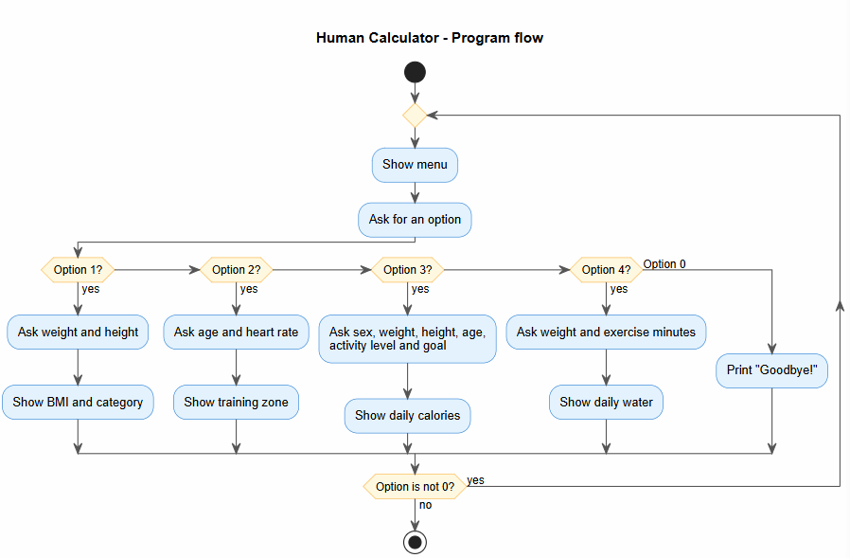

# Human Calculator

## Purpose

Human Calculator is a console program with four health and sport calculators in one menu:

1. **BMI calculator**: Body Mass Index and its who category (underweight, normal weight, overweight, obesity).
2. **Heart rate training zone**: in which training zone (0-5) you are, based on your age and current heart rate.
3. **Daily calories**: recommended daily calories depending on your data, activity level and goal (lose, maintain or gain weight).
4. **Daily water**: recommended daily water intake depending on your weight and exercise time.

The program (`src/interface.py`) shows the options, asks only for the data needed by the chosen calculation (option) and prints the result.

**Target audience:** people who are starting to train or want a quick estimate about their health habits.

## Installation

Requirements: **Python 3.8 or newer**.
The program has **no external dependencies**: it only uses the Python standard library, so `requirements.txt` contains no packages.
Also the installation of **Visual Studio Code**.

```bash
git clone https://github.com/iris77m/semestral-work-ite.git
cd semestral-work-ite
```

```bash
py -m venv .venv   # Windows
.venv\Scripts\activate
```

## Usage

Run the program from the project root:

```bash
python main.py
```

A menu appears. Type the number of the option you want and press Enter, then answer the questions. After each result the menu is shown again; type `0` to exit.

```
---> Human Calculator <---
1) BMI calculator
2) Heart rate training zone
3) Daily calories
4) Daily water
0) Exit
```

### Inputs and outputs

| Option | Inputs (valid range) | Output |
|---|---|---|
| 1 BMI | weight in kg (1-300), height in cm (1-300) | BMI value and category |
| 2 Heart zone | age in years (1-100), current heart rate in bpm (30-230) | estimated max heart rate, % of max and zone 0-5 |
| 3 Calories | sex (`m`/`f`), weight in kg(1-300), height in cm (1-300), age in years (1-100), activity level (1-5), goal (`lose`/`maintain`/`gain`) | recommended kcal per day |
| 4 Water | weight in kg (1-300), exercise minutes per day (0-1000) | ml per day and litres |

Activity levels: 1 sedentary, 2 light, 3 moderate, 4 high, 5 very high.

Numbers can be typed with a decimal dot or comma (`70.5` or `70,5`). If a value is not a number or is out of range, the program explains the problem and asks again.

### Example (option 1)

```
Choose an option: 1
Weight (kg): 70
Height (cm): 175
Your BMI is 22.9 (Normal weight).
```

## Tests

Run all tests with a single command:

```bash
python test_main.py
```

The testing approach, rationale and sample input/output pairs are described in [docs/tests.md](docs/tests.md).

## Project structure

```
semestral-work-ite/
├── docs/
│   ├── diagrams/
│   │   ├── modules.png
│   │   └── program_flow.png
│   ├── notes.md
│   └── tests.md
├── src/
│   ├── __init__.py
│   ├── calculator.py
│   └── interface.py
├── tests/
│   ├── __init__.py
│   ├── test_calculator.py
│   └── test_interface.py
├── .gitignore
├── LICENSE
├── main.py
├── README.md
├── requirements.txt
└── test_main.py
```
### Program logic and flow

The main menu loops through options `1`–`4` until option `0` is selected, validating numeric and choice inputs before calling the calculation functions in `src/calculator.py`.



## Limitations and known issues

- Results are **estimates** based on general formulas (Mifflin-St Jeor for calories, Tanaka for maximum heart rate, WHO ranges for BMI). They are **not medical advice**.
- BMI does not distinguish muscle from fat, so it can be misleading for very muscular people.
- The calorie calculation only supports `male` and `female`, because the formula needs that value.
- Heart rate zones use an estimated maximum heart rate, not a measured one.
- Console only and English only; results are not saved.
- Input is only checked against ranges; extreme but allowed values (for example a height of 1 cm) still produce a result.

## License

See the `LICENSE` file.
